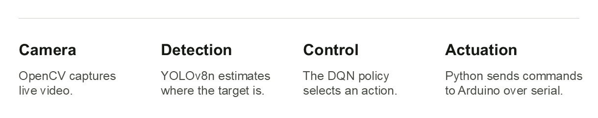
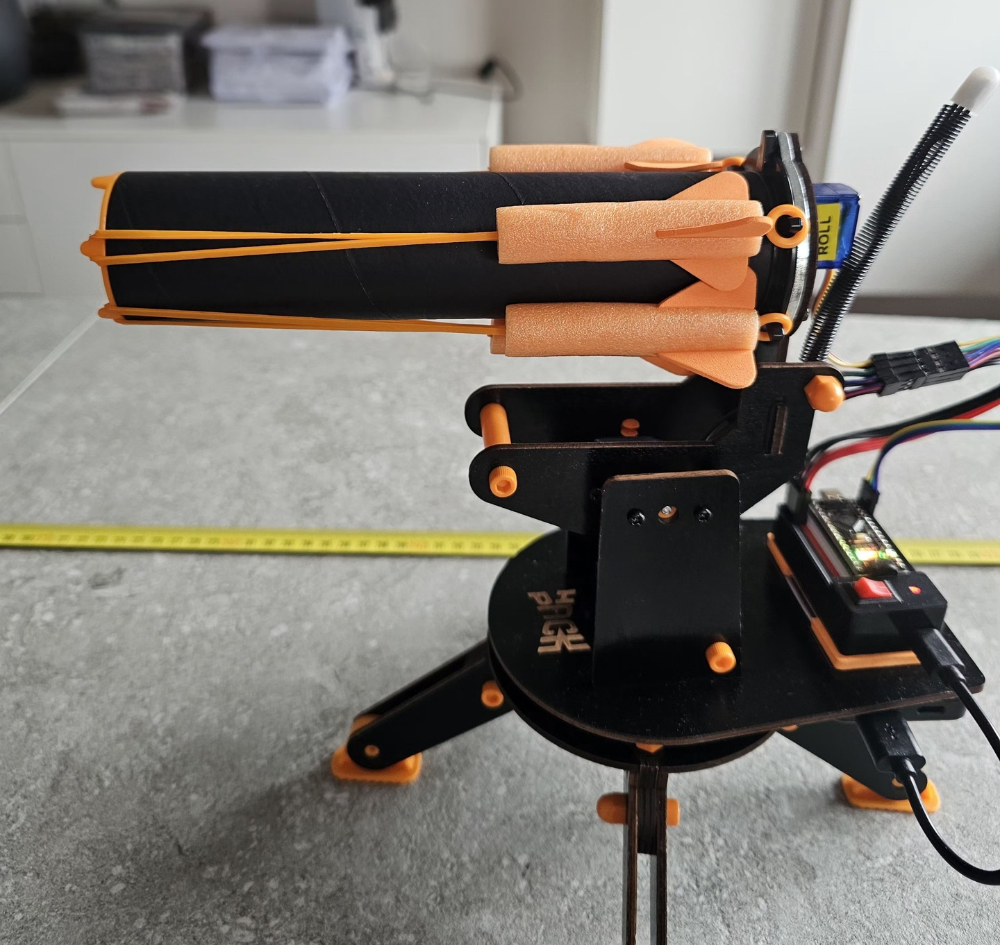
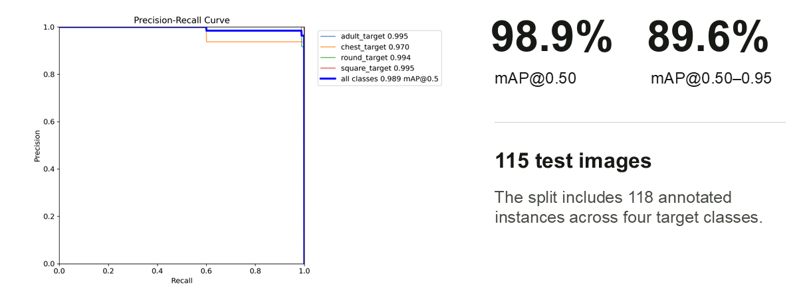

# Camera-Guided Turret with YOLOv8 and DQN

I built a system that aims a desktop foam-dart turret at printed targets. YOLOv8n locates the target in the webcam feed, a DQN policy chooses how to aim, and Python sends commands to Arduino over USB serial.

[Notebooks](#notebooks) · [Hardware demos](#hardware-demos) · [Project slides](docs/ir-target-tracking.pptx)

## Hardware demos

Each video shows the camera and control loop in action, followed by a phone view of the prototype.

<table>
  <tr>
    <td align="center">
      <a href="https://youtu.be/mGippGd279k"></a><br>
      <a href="https://youtu.be/mGippGd279k">Shot 1</a>
    </td>
    <td align="center">
      <a href="https://youtu.be/KS9mdomQKo0"></a><br>
      <a href="https://youtu.be/KS9mdomQKo0">Shot 2</a>
    </td>
    <td align="center">
      <a href="https://youtu.be/VWXIKj431Yc"></a><br>
      <a href="https://youtu.be/VWXIKj431Yc">Shot 3</a>
    </td>
  </tr>
</table>

## Notebooks

| Notebook | What I worked on | Kaggle |
| --- | --- | --- |
| [01 · Physics and reinforcement learning](notebooks/01-reinforcement-learning.ipynb) | Measured dart velocity with Tracker, built a Gymnasium environment around the trajectory model and trained DQN for 100,000 steps. | [Open on Kaggle](https://www.kaggle.com/code/jorgesu040/parte1-rl-gymnasium) |
| [02 · Target detection](notebooks/02-yolov8-detector.ipynb) | Fine-tuned YOLOv8n on Shooting Target, analysed detection errors and evaluated the model on 115 held-out images. | [Open on Kaggle](https://www.kaggle.com/code/jorgesu040/parte2-cnn-visionartificial) |
| [03 · Camera and Arduino](notebooks/03-camera-and-arduino.ipynb) | Combined both models in an OpenCV loop, calibrated pixel offsets against servo angles and sent the policy's actions to Arduino. Includes all three recorded trials. | [Open on Kaggle](https://www.kaggle.com/code/jorgesu040/parte3-aplicacion-rl-cv-en-el-mundo-real) |

## From camera to servos

[](docs/ir-target-tracking.pptx)

The policy takes the target offset and estimated yaw and pitch as input. Its actions move the servos or trigger a shot. The [Arduino sketch](firmware/turret/turret.ino) handles the serial commands.



## Detector results

YOLOv8n reached **98.9% mAP@0.50** and **89.6% mAP@0.50–0.95** on 115 held-out images with 118 labelled targets across four classes.

[](docs/ir-target-tracking.pptx)

## Run a notebook

Use Python 3.12 and launch Jupyter from the repository root.

```sh
python -m pip install -r requirements.txt
python -m jupyter lab
```

- **Simulation.** Run notebook 01 through “Probar la política guardada” to use the included [DQN checkpoint](models/dqn-policy.zip) and [velocity measurements](data/velocidad.csv).
- **Image demo.** Run notebook 03 through “Prueba con una imagen” to detect a target on CPU with the included [YOLOv8n weights](models/best.pt) and [example image](data/demo/target.jpg).
- **Detector training and evaluation.** Download the [Shooting Target v4 YOLOv8 export](https://universe.roboflow.com/final-project-lmkzv/shooting-target/dataset/4). Place its `data.yaml`, `train`, `valid` and `test` folders under `data/shooting-target` or point `SHOOTING_TARGET_DIR` at the export. Notebook 02 can evaluate the saved checkpoint on CPU.
- **Live camera.** Run notebook 03 locally for the OpenCV window. Set `CAMERA_INDEX` for your camera and keep `SERIAL_PORT = None` for a webcam preview. For the physical prototype, flash the [Arduino sketch](firmware/turret/turret.ino) and set `SERIAL_PORT`.

## Credits

Academic project by Jorge Matesanz Hernando at U-tad. The CrunchLabs sketch retains its MIT notice. The example image is from [Shooting Target v4 by Final Project](https://universe.roboflow.com/final-project-lmkzv/shooting-target/dataset/4) under [CC BY 4.0](https://creativecommons.org/licenses/by/4.0/). See the [license notices](licenses/README.md) for the notebooks, firmware and YOLOv8n weights.
